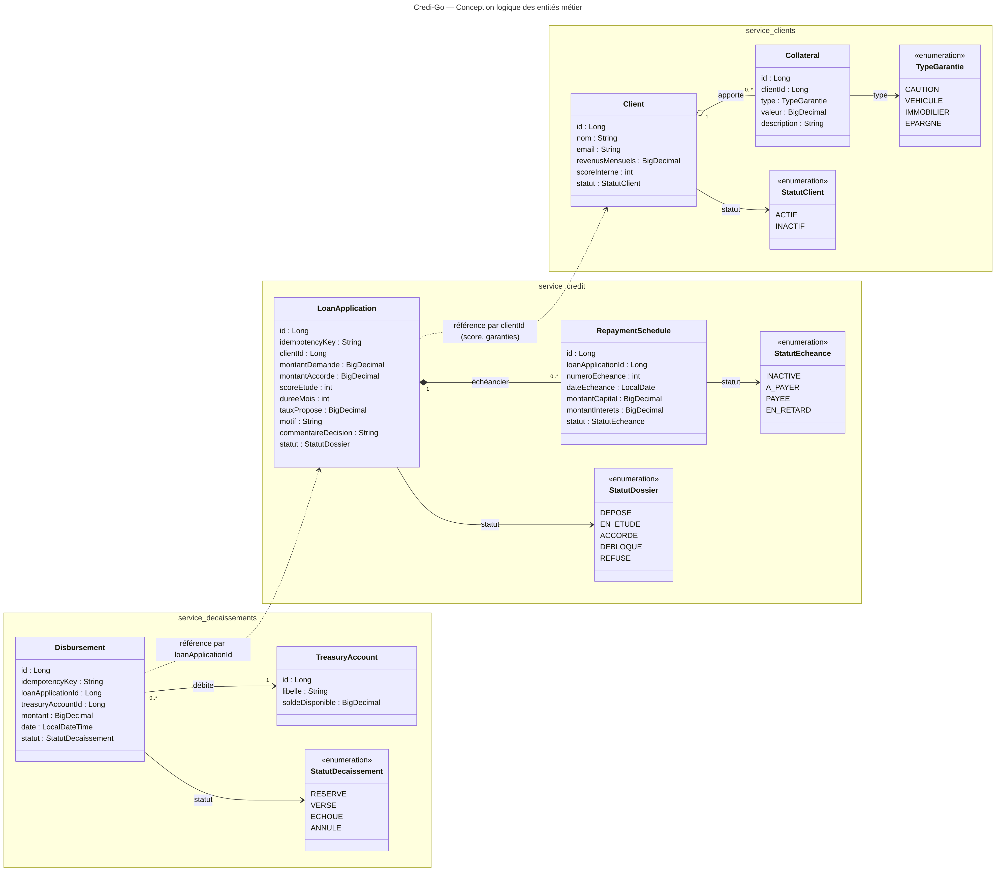
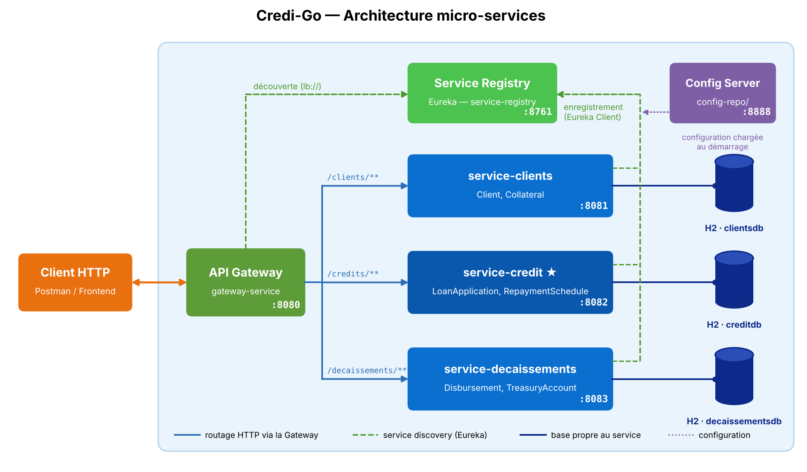

# Credi-Go

Projet de module réalisé dans le cadre de la formation **J2EE Avancée et Spring Boot** (5ème année DSI, EMSI), enseignée par **M. KHALIL Salim**.

**Credi-Go** est une plateforme d'octroi de **crédits à la consommation** en architecture micro-services. Un client dépose une demande de crédit, son dossier est **scoré** puis **étudié** ; la décision d'accord déclenche la préparation du **décaissement** (vérification et réservation de la trésorerie), et le versement effectif **active l'échéancier de remboursement**.

**Unité de traitement : le Dossier de crédit** (`LoanApplication`) — un demandeur, un montant, une durée, un taux, un statut :

```
DEPOSE ──► EN_ETUDE ──► ACCORDE ──► DEBLOQUE
                 └──────────► REFUSE
```

Stack : Java 17 · Spring Boot 3.5.6 · Spring Cloud 2025.0.0 (Eureka, Gateway, Config, OpenFeign, Resilience4j) · RabbitMQ · Maven multi-modules · bases H2 en mémoire (une par service).

## Services

| Application | Port | Responsabilité | Entités |
|---|---|---|---|
| `service-registry` | 8761 | Annuaire Eureka : enregistrement et découverte des services | — |
| `config-server` | 8888 | Configuration centralisée (dossier `config-repo/`) | — |
| `gateway-service` | 8080 | API Gateway (Spring Cloud Gateway réactive), point d'entrée unique | — |
| `service-clients` | 8081 | Clients demandeurs de crédit et garanties apportées | `Client`, `Collateral` |
| `service-credit` ★ | 8082 | Dossiers de crédit et échéanciers *(service principal)* | `LoanApplication`, `RepaymentSchedule` |
| `service-decaissements` | 8083 | Versements des crédits et trésorerie | `Disbursement`, `TreasuryAccount` |
| `notification-service` | 8084 | Consomme les événements RabbitMQ et envoie les emails | — |
| RabbitMQ *(Docker)* | 5672 / 15672 | Broker de messages (file `credigo.notifications.email`) | — |
| MailHog *(Docker)* | 1025 / 8025 | Serveur SMTP de test et boîte de réception web | — |

## Diagramme de classes



Chaque service possède ses propres données. À l'intérieur d'un service, les entités sont liées localement (ex. `LoanApplication` → `RepaymentSchedule`). **Entre services, une référence est un simple identifiant** (`clientId`, `loanApplicationId`), sans association JPA : les flèches en pointillés matérialisent ces dépendances, sans préjuger du protocole de communication.

Source éditable du diagramme : [`docs/diagramme-classes.mmd`](docs/diagramme-classes.mmd) (Mermaid).

## Architecture du projet



## Prérequis

- JDK 17
- Maven 3.9+ (ou le wrapper fourni `mvnw` / `mvnw.cmd`)
- IntelliJ IDEA (recommandé) et Postman
- Docker Desktop (RabbitMQ et MailHog, à partir du jalon V5)

## Lancement

Compiler tous les modules depuis la racine :

```bash
./mvnw clean package -DskipTests        # Windows : .\mvnw.cmd clean package -DskipTests
```

Démarrer RabbitMQ et MailHog :

```bash
docker compose up -d
```

Puis démarrer les applications **dans cet ordre** (bouton Run d'IntelliJ, ou `./mvnw -pl <module> spring-boot:run`) :

| Ordre | Application | Vérification |
|---|---|---|
| 1 | `service-registry` | http://localhost:8761 |
| 2 | `config-server` | http://localhost:8888/service-clients/default |
| 3 | `service-clients`, `service-credit`, `service-decaissements`, `notification-service` | statut UP dans Eureka |
| 4 | `gateway-service` | http://localhost:8080/service-clients/clients |

Les services métier ne contiennent que `spring.application.name` et `spring.config.import` : port, base H2 et URL d'Eureka sont **chargés depuis le Config Server** (`config-repo/<nom-du-service>.properties` + `config-repo/application.properties` commun).

**Config Server** : profil `native` par défaut (lecture du dossier local `config-repo/`). Profil `git` disponible (`application-git.properties`) pour lire `config-repo/` depuis ce dépôt GitHub, comme dans le TP.

**Gateway** :
- sans profil → **routage dynamique** via Eureka : `http://localhost:8080/service-credit/credits`
- profil `statique` → **routes déclarées** avec répartition de charge `lb://` : `http://localhost:8080/credits`

Console H2 de chaque service : `http://localhost:808x/h2-console` (JDBC URL `jdbc:h2:mem:clientsdb`, `creditdb` ou `decaissementsdb`, utilisateur `sa`).

## Endpoints

| Service | Méthode et chemin | Description |
|---|---|---|
| clients | `GET/POST /clients`, `GET/PUT/DELETE /clients/{id}` | CRUD des clients (suppression refusée s'il a des garanties) |
| clients | `POST /clients/{id}/activation`, `/desactivation` | Changement de statut par opération dédiée |
| clients | `GET /clients/{id}/garanties` | Garanties d'un client |
| clients | `GET/POST /garanties`, `GET/PUT/DELETE /garanties/{id}` | CRUD des garanties (client existant et actif) |
| credit | `GET /credits[?clientId=&statut=]`, `POST /credits` | Liste et dépôt d'une demande (statut `DEPOSE`) |
| credit | `GET/PUT/DELETE /credits/{id}` | Modification si `DEPOSE`, suppression si `DEPOSE` ou `REFUSE` |
| credit | `GET /credits/{id}/echeancier` | Échéancier d'un dossier |
| decaissements | `GET/POST /tresoreries`, `GET/PUT/DELETE /tresoreries/{id}` | CRUD des comptes (seul le libellé est modifiable par PUT) |
| decaissements | `POST /tresoreries/{id}/approvisionnement` | Augmente le solde disponible |
| decaissements | `GET /decaissements[?dossierId=]`, `GET /decaissements/{id}` | Consultation des versements |
| credit | `POST /credits/{id}/etude` | `DEPOSE` → `EN_ETUDE` : score du client relevé via OpenFeign |
| credit | `POST /credits/{id}/decision` | `EN_ETUDE` → `ACCORDE` (échéancier généré `INACTIVE`, notification) ou `REFUSE` |
| credit | `POST /credits/{id}/deblocage` | `ACCORDE` → `DEBLOQUE`, échéancier `A_PAYER` (appelé par service-decaissements) |
| credit | `GET /credits/{id}/details` | Consultation enrichie : dossier + client + garanties + échéancier + décaissements |
| decaissements | `POST /decaissements` | Versement du montant accordé (dossier `ACCORDE`, client actif, solde suffisant), notification |
| notification | `GET /notifications` | Dernières notifications consommées et statut d'envoi |

`POST /credits` et `POST /decaissements` acceptent l'en-tête **`Idempotency-Key`** : une requête rejouée avec la même clé renvoie `200` et la ressource déjà créée, sans doublon.

Codes de retour : `200`, `201` (création + en-tête `Location`), `204` (suppression), `400` (validation, avec le détail des champs), `404` (ressource inexistante, locale ou distante), `409` (règle métier), `503` (service distant indisponible).

## Tests Postman

Importer `postman/Credi-Go.postman_collection.json`. Chaque requête contient un test automatique du code HTTP attendu ; la collection complète peut être exécutée avec le **Collection Runner** (relancer les services avant pour repartir des données de `data.sql`).

| Dossier | Contenu |
|---|---|
| 0 - Infrastructure | Services UP dans Eureka, configurations servies par le Config Server |
| 1 à 3 - Services (accès direct) | CRUD : cas valides, erreurs de validation (400), ressources inexistantes (404), règles métier (409) |
| 4 - Gateway dynamique | Mêmes ressources via `/{nom-du-service}/...` |
| 5 - Gateway statique | Routes déclarées (lancer la gateway avec le profil `statique`) |
| 6 - V4 : flux du crédit | Dépôt, étude, décision, versement, déblocage, consultation enrichie, refus, rejeux idempotents |
| 7 - V5 : notifications | Messages consommés par notification-service et emails reçus dans MailHog |
| 8 - V6 : résilience | À lancer manuellement en arrêtant un service : 503 en création, réponse partielle en consultation |

## Communication entre services

**Synchrone (OpenFeign, V4)** — chaque référence distante est vérifiée **avant** toute écriture :

| Appelant | Appelé | Vérification |
|---|---|---|
| service-credit | service-clients | client existant et `ACTIF` au dépôt, score à l'étude, revenus et garanties à la décision |
| service-decaissements | service-credit | dossier `ACCORDE` et `montantAccorde` avant versement, puis déblocage |
| service-decaissements | service-clients | client `ACTIF` avant versement |
| service-credit | service-decaissements | décaissements du dossier (consultation enrichie) |

**Asynchrone (RabbitMQ, V5)** — les événements sont publiés **après le commit** de l'opération métier, puis consommés par `notification-service` qui envoie l'email (visible sur http://localhost:8025) :

| Événement | Publié par | Déclencheur |
|---|---|---|
| `LOAN_APPROVED` | service-credit | décision d'accord |
| `DISBURSEMENT_PAID` | service-decaissements | versement effectif des fonds |

**Résilience (V6)** — tous les appels OpenFeign passent par `ResilientRequests` :
- **Timeout** : `connectTimeout` 1 s, `readTimeout` 2 s ;
- **Retry** : 3 tentatives sur erreur transitoire (service injoignable, 503) ;
- **Circuit Breaker** : ouvert à 50 % d'échecs sur 6 appels, les erreurs 4xx ne comptent pas (état : `/actuator/circuitbreakers`) ;
- **Repli** strict en écriture (`503`, opération refusée) et tolérant en consultation enrichie (réponse partielle, `donneesPartielles: true`) ;
- **Erreurs** centralisées par `@RestControllerAdvice` ; **idempotence** des créations par `Idempotency-Key`.

## Règles métier principales

- Un dossier n'est étudié qu'une fois le **score du client** connu. La décision (`ACCORDE` / `REFUSE`) fixe `montantAccorde`, `tauxPropose` et `commentaireDecision` :
  - taux selon le score : ≥ 750 → 5,50 % ; ≥ 650 → 6,50 % ; ≥ 550 → 7,50 % ; en dessous → refus ;
  - la 1ère mensualité ne dépasse pas **40 % des revenus** (sinon accord partiel, ou refus sous 50 % du montant demandé) ;
  - au-delà de 100 000 MAD, les garanties doivent couvrir au moins 30 % du montant.
- Un décaissement n'est possible que pour un dossier `ACCORDE`, d'un client actif, dans la limite du **solde disponible** de la trésorerie, réservé et débité dans la transaction locale.
- Le montant accordé n'est **versé qu'une seule fois** ; si le déblocage échoue côté service-credit, la transaction locale est annulée : les fonds sont libérés et le dossier reste `ACCORDE` (décaissement à reprendre).
- L'**échéancier** n'est activé qu'après le **versement effectif** (dossier `DEBLOQUE`).

## Feuille de route des jalons

| Jalon | Contenu pour Credi-Go | Tag |
|---|---|---|
| Init | Description, diagramme de classes, architecture (ce README) | — |
| V1 | CRUD : `Client`, `Collateral` (service-clients) ; `TreasuryAccount` (service-decaissements) | `v1.0` |
| V2 | Eureka (`service-registry`) + API Gateway (routage dynamique et statique) | `v2.0` |
| V3 | Config Server : configuration centralisée | `v3.0` |
| V4 | OpenFeign : étude, décision, échéancier, versement et déblocage ; vérification des références distantes avant écriture ; consultation enrichie d'un dossier | `v4.0` |
| V5 | RabbitMQ : `notification-service` notifie le client de l'accord de son crédit et du versement des fonds (MailHog) | `v5.0` |
| V6 | Résilience (Resilience4j : Retry, Circuit Breaker, timeouts), gestion globale des erreurs, idempotence des créations | `v6.0` |
| V7 | Kafka : `application-deposited`, `client-scored`, `loan-approved`, `disbursement-paid`, `disbursement-failed` ; notifications migrées de RabbitMQ vers Kafka | à venir |

Bonus envisagé : job batch mensuel de traitement des échéances (relances des retardataires, calcul des intérêts) et tableau d'amortissement côté Angular.
